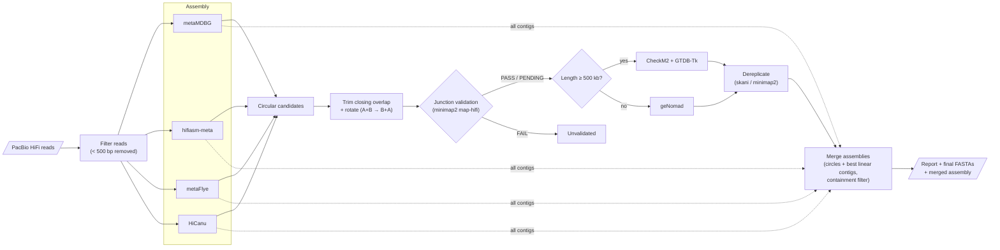

# OuroAssemble

**OuroAssemble** recovers and validates **circular genomes** (complete chromosomes,
plasmids and viruses) from a **PacBio HiFi metagenome**. It assembles the reads with
four metagenome assemblers, collects every contig an assembler marks as circular,
checks each circular junction with the HiFi reads, classifies the survivors and
dereplicates genomes found by more than one assembler. It then combines the four
assemblies into one **non-redundant merged assembly** in which validated circles come
first and the best-supported linear contigs from any assembler fill in the rest.



## Installation

OuroAssemble needs Linux, conda (or mamba) and Snakemake ≥ 9.2. The bioinformatics tools
are installed automatically into one conda environment per step the first time the
pipeline runs.

**With pixi**

```bash
git clone https://github.com/SilentGene/OuroAssemble.git && cd OuroAssemble
pixi install
pixi run ouroassemble --help
```

**With conda/mamba**

```bash
git clone https://github.com/SilentGene/OuroAssemble.git && cd OuroAssemble
mamba env create -f environment.yaml
conda activate ouroassemble
ouroassemble --help
```

### Databases

| Database | Used for | Size |
|---|---|---|
| CheckM2 (`uniref100.KO.1.dmnd`) | completeness / contamination | ~3 GB |
| GTDB-Tk reference data (R232 for GTDB-Tk 2.8) | taxonomy, closest reference | ~140 GB |
| geNomad database | plasmid / virus detection | ~1.5 GB |

```bash
ouroassemble download-db all -d /path/to/db       # or: checkm2 | gtdbtk | genomad
```

Give their locations in the config (`databases:`), on the command line
(`--checkm2-db`, `--gtdbtk-db`, `--genomad-db`) or with the environment variables
`OUROASSEMBLE_CHECKM2_DB`, `OUROASSEMBLE_GTDBTK_DB`, `OUROASSEMBLE_GENOMAD_DB` and
`OUROASSEMBLE_GTDB_METADATA` (comma-separated `bac120/ar53_metadata_*.tsv.gz`, used to
compare genome lengths with the closest reference). Any of the three steps can be
skipped with `--skip-checkm2`, `--skip-gtdbtk` or `--skip-genomad`.

## Quick start

```bash
ouroassemble run -r hifi_reads.fq.gz -o results -t 32
```

Useful options:

```bash
ouroassemble init-config -o my.yaml  # Export a config file so an expert like you can edit every parameter manually
ouroassemble run -c my.yaml -o results -t 32  # Run the pipeline using the edited/reviewed config file
ouroassemble run -r reads.fq.gz -o results -a metaflye,metamdbg     # subset of assemblers
ouroassemble run -r reads.fq.gz -o results -t 32 -m 200             # use at most 200 GB RAM
ouroassemble run -r reads.fq.gz -o results --profile my_cluster     # Snakemake profile
ouroassemble run -r reads.fq.gz -o results -n                       # dry run
ouroassemble run -r reads.fq.gz -o results -- --keep-going          # extra Snakemake args
```

`-m/--memory` caps the memory of every job at the given number of GB (each step's own
`mem_mb` in the config is used if it is lower). When running locally it also keeps the
total memory of jobs running at the same time below that value; with `--profile` it is
the largest amount a single cluster job requests. Per-step values can be set in the
config (`<step>: {mem_mb: ...}`).

Set `OUROASSEMBLE_CONDA_PREFIX` (or `--conda-prefix`) to share the rule environments
between runs instead of rebuilding them in every output directory.

### Example data

```bash
pixi run example-data   # downloads 5 small public genomes and simulates HiFi reads
pixi run example        # runs the pipeline on them (example/output)
```

## Outputs

| Path | Content |
|---|---|
| `final/report.html` | self-contained HTML report (open in any browser, works offline) |
| `final/circular_genomes.tsv` | every circular candidate with all metrics, category and cluster |
| `final/chromosomes.fa` | dereplicated complete chromosomes (junction PASS, CheckM2 thresholds) |
| `final/plasmids.fa`, `final/viruses.fa` | dereplicated geNomad plasmids / viruses (PASS) |
| `final/other_circular.fa` | other dereplicated circular sequences (PASS) |
| `final/pending_review.fa` | representatives that need manual review (PENDING) |
| `final/merged_assembly.fa` | non-redundant assembly combining all assemblers |
| `final/merged_assembly.tsv` | provenance of every pooled contig: rank, tier, kept / redundant with |
| `05_validation/<assembler>/` | read alignments, junction metrics, suspicious sites, IGV batch script |

See [docs/usage.md](docs/usage.md) for the method, every parameter and all
intermediate files.

## Method in brief

1. Reads < 500 bp are removed (`seqkit`).
2. The reads are assembled with **metaMDBG**, **hifiasm-meta**, **metaFlye**
   (`--pacbio-hifi --meta`) and **HiCanu** (`-pacbio-hifi`, `maxInputCoverage=10000
   corOutCoverage=10000 corMhapSensitivity=high corMinCoverage=0 genomeSize=5m`).
3. Circular contigs are taken from each assembler's own marker (`circular=yes`,
   IDs ending in `c`, `assembly_info.txt` `circ.=Y`, `suggestCircular=yes`).
4. A duplicated closing overlap is removed and each candidate is rotated at its
   midpoint so the circular junction lies inside the sequence.
5. Reads are mapped (`minimap2 -ax map-hifi`) to the rotated candidates *together
   with all other contigs of the same assembly*. A junction **PASSes** when several
   uniquely placed reads cross it with anchors on both sides and the rest of the
   contig shows no clip pile-ups or coverage gaps; otherwise it is **PENDING**
   (low coverage, repeat, other suspicious sites) or **FAIL**.
6. Large validated circles (≥ 500 kb) are assessed one FASTA per contig with
   **CheckM2** and **GTDB-Tk**; smaller ones are screened with **geNomad**.
7. Circles shared between assemblers (≥ 99 % ANI, ≥ 90 % aligned fraction both ways;
   skani or minimap2) are collapsed to one representative.
8. **Merged assembly.** Contigs from all assemblers are pooled and ranked: validated
   circles, then PENDING circles, then linear contigs (fewer clip pile-ups / coverage
   gaps in the HiFi re-mapping → longer → assembler priority). Walking down that ranking,
   a contig is dropped when ≥ 90 % of it is already covered at ≥ 99 % identity by kept
   contigs (minimap2 all-vs-all). Contigs are never cut or joined, so no new chimeras
   are introduced; strain variants < 99 % identity are kept. The report compares the
   merged assembly with each assembler (contigs, N50, validated circles, % reads mapped)
   and shows how much each assembler contributed.

## License

AGPL-3.0-or-later — see [LICENSE](LICENSE).

## Contact

Heyu Lin - heyu.lin🌀qut.edu.au

...🧙‍♂️🧬